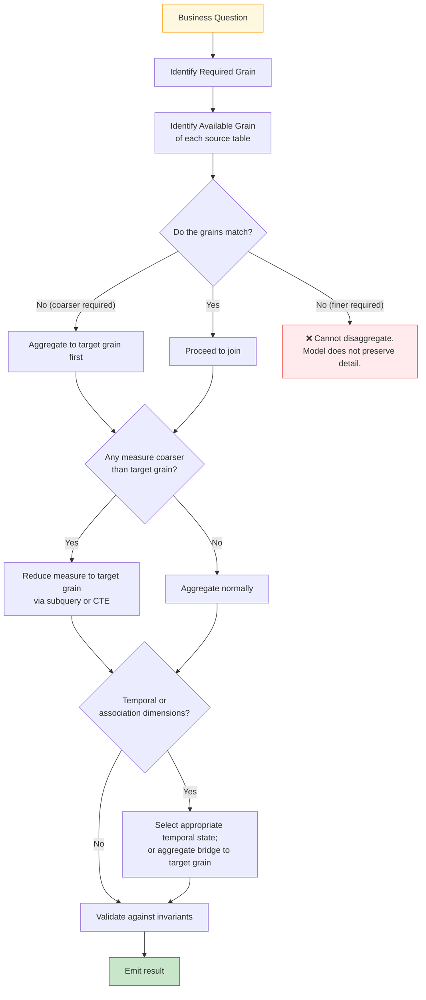

# 🗄️🤖 SQL & GenAI Course
**🎯 Quality Education for Anyone, Anywhere, Anytime — 💫 with Comfort, Convenience at no Cost**

---

# 03C-3 — Invariants and Guardrail
## Grain + Joins: Mathematics — Volume 3 of 3

**Document Type:** Grain Foundations — Part 3C, Volume 3 of 3
**Version:** 1.1
**Status:** FROZEN
**Domain:** FinVERSE / ACQUIRE Banking Core
**Level:** Production Skills & Mathematical Execution Principles
**Location:** `SQLVerse-Architects-Blueprint/02-GRAIN-FOUNDATIONS/03C-grain-joins-mathematics/`
**Governing Standard:** `SQLVERSE-ARCH-FW-001`

> **v1.1** — Split from the single `03C-grain-joins-mathematics.md` into three volumes. Volume 3 contains Parts 3–6 and the closing.

---

> **Every row has meaning.**
> **Every meaning has a law.**
> **Every law is based on mathematics.**

---

> **SQLVerse Acknowledgment**
>
> SQLVerse recognises the foundational contributions of mathematicians and logicians whose work underpins relational databases — Codd, Date, Codd's theorem, relational algebra. Every query you write stands on their shoulders.

---

*Continues from [Volume 2 — Measures and Association](03C-2-measure-and-association.md). That volume completed the six mathematical discoveries. This volume turns them from description into prescription.*

---

## 🛡️ Part 3 — The Five Invariants

The discoveries are descriptive. They tell us what happens.

Invariants are prescriptive. They tell us what must remain true.

An invariant is not a rule. A rule says *"do this."* An invariant says *"if you did not violate this, your answer is valid."*

If any invariant is violated, the analysis is mathematically invalid — regardless of whether the SQL ran.

---

### Invariant I — The Grain Invariant

> **Every output row must have one unambiguous business meaning.**

If a query result contains rows whose grain is not clearly defined, the result cannot be trusted. The analyst must be able to state, in one sentence, what one row of the output represents.

This is the foundation. Without it, no other invariant can be checked.

---

### Invariant II — The Measure Invariant

> **A measure must not be counted at a grain that causes unintended replication.**

If a measure's native grain is coarser than the joined row set, and the measure is aggregated without first reducing it to the target grain, the invariant is violated — and the result is mathematically wrong.

---

### Invariant III — The Cardinality Invariant

> **A JOIN must not introduce multiplicity that the business question did not intend.**

Cardinality is a property of the relationship between the tables. If the relationship permits 1:N, or M:N, or independent parallel branches, the join will produce multiplicity. That multiplicity is correct only if the business question *wanted* it.

---

### Invariant IV — The Temporal Meaning Invariant

> **A state must be evaluated at the temporal boundary required by the question.**

If the business question asks for "the balance on June 30," the answer is a **selected state**, not a **summed sequence**. Confusing the two violates the invariant.

---

### Invariant V — The Conservation Invariant

> **Detail total = correctly aggregated higher-level total — *only when the measure is additive across that dimension*.**

This is the invariant that ties everything together. If a measure is additive — like transaction amounts, payments, or events — then the sum of the details must equal the aggregate at any coarser grain.

If a measure is **not** additive — like balances, limits, or states — then conservation does **not** hold, and treating the measure as if it were additive is a violation.

**The caveat is not a footnote. It is the invariant.**

---

## 🧠 Part 4 — Pattern Discovery

The invariants are universal. The question now is:

> **Did our investigations reveal a reusable mathematical procedure?**

They did.

---

### 4.1 — PATTERN-001 — Structured Grain Analysis

We have called this pattern **"Structured Grain Analysis"** in the Framework. Until now, it may have seemed like a checklist.

Now — after the mathematics — it appears for what it always was: **an algorithmic consequence of the invariants.**

```
Business Question
    ↓
Required Grain          (What must ONE output row represent?)
    ↓
Available Grain         (What does ONE row of each source table represent?)
    ↓
Join Structure          (What multiplicities does each path introduce?)
    ↓
Multiplicity            (How do those multiplicities compose?)
    ↓
Measure Grain           (Which measures are coarser than the target?)
    ↓
Aggregation             (At what grain must aggregation occur?)
    ↓
Validation              (Does the result satisfy the invariants?)
```

Each step is not a rule someone invented. Each step is a **mathematical necessity** — a checkpoint against the invariants.

The pattern is not prescriptive pedagogy. It is **derived procedure**.

---

### 4.2 — Derivation from the Mathematics

Let us trace the derivation explicitly:

| Step | Mathematical Justification |
|------|----------------------------|
| Required Grain | Invariant I — Grain must be unambiguous |
| Available Grain | Invariant I — the source tables must be understood |
| Join Structure | Invariant III — cardinality determines multiplicity |
| Multiplicity | Discovery 2 — multiplicities compose |
| Measure Grain | Discovery 4 — measures carry their own grain |
| Aggregation | Invariant II — avoid unintended replication |
| Validation | Invariant V — conservation confirms correctness |

The pattern is the **sequence of invariant checks** that the mathematics requires.

---

### 4.3 — The Algorithmic Consequence

Because the pattern is derived, it is **not optional**.

An analyst who skips a step is not "taking a shortcut" — they are **skipping a mathematical checkpoint**. The result is not "probably fine." The result is **provably wrong** if any invariant is violated.

This is why the pattern must be applied *before* the query is written, not after.

---

## 🛡️ Part 5 — The Artisan's Guardrail

The Guardrail is not a motto. It is not a checklist someone decided to add at the end.

**It is the derived principle that emerges from the mathematics.**

---

### 5.1 — The Derived Principle

From the investigations, the mathematics, and the invariants:

> **Reduce each measure to a grain compatible with the target result before exposing it to multiplicative joins.**

This is the principle. It is not a suggestion. It is the **necessary condition** for Invariant II and Invariant V to hold.

Every fan-out error we examined in Investigations I–V was a violation of this principle.

Every correct query we wrote was a satisfaction of it.

---

### 5.2 — The 5-Question Checklist

Before writing any query that joins tables or aggregates measures:

**1. What does ONE row of the target result represent?**
   — *Required Grain*

**2. What does ONE row of each source table represent?**
   — *Available Grain*

**3. What is the cardinality of each join path?**
   — *Multiplicity*

**4. Does any measure carry a grain coarser than the joined row set?**
   — *Measure Grain*

**5. Do temporal, association, or parallel dimensions multiply the row set?**
   — *Dimensional Check*

**If any answer reveals a mismatch, aggregate first.**

---

### 5.3 — The Guardrail Decision Tree



---

### 5.4 — Application to the Case Studies

The Guardrail is not confined to the Banking domain. It is universal. It will be applied — explicitly — in each of the seven case studies that follow.

| Case Study | Domain | Grain Challenge |
|-----------|--------|-----------------|
| **01 — Price Freeze** | E-Store | Historical price vs. current price — a temporal grain problem |
| **02 — Order Status Gap** | E-Store | Current status vs. status history — a temporal grain problem |
| **03 — Valuation Gap** | Real Estate | Static valuation vs. valuation timeline |
| **04 — Time-to-Sale Gap** | Real Estate | Listing date, sale date — a temporal span problem |
| **05 — Inpatient Blackhole** | Hospital | Admission and discharge — a temporal boundary problem |
| **06 — Liquidity Illusion** | FinVERSE | Current balance vs. transaction flow — additive vs selection |
| **07 — Risk-Ticket Ambiguity** | FinVERSE | Requirement ambiguity — a grain definition problem |

Each case study is a **new domain**. Each will require the same Guardrail.

This is the universality of the mathematics. The domains change. The law does not.

---

## 🌐 Part 6 — The Culminating Realization

We can now draw the full picture.

The investigations, the discoveries, the invariants, the pattern, and the guardrail all describe the same underlying structure.

```
                     GRAIN
                       │
          ┌────────────┼────────────┐
          ▼            ▼            ▼
       ENTITY     ASSOCIATION    TEMPORAL
          │            │            │
          └────────────┼────────────┘
                       ▼
             RELATIONSHIP MULTIPLICITY
                       │
                       ▼
                  ROW-SET SHAPE
                       │
                       ▼
                  MEASURE GRAIN
                       │
                       ▼
                  AGGREGATION
                       │
                       ▼
                BUSINESS RESULT
```

**Grain** is the starting coordinate — entity, association, time.

**Relationship multiplicity** is the mathematical operator that transforms the row set.

**Row-set shape** is the result of applying that operator.

**Measure grain** is the property of the measure that must be aligned with the row set.

**Aggregation** is the transformation of measures from their native grain to the target grain.

**Business result** is the final answer — correct if and only if every invariant held.

Now — the closing line:

> **SQL is the language through which these mathematical relationships are executed.**

SQL does not create the mathematics. SQL **expresses** it. Every `JOIN`, every `GROUP BY`, every `SUM`, every `WHERE` is a syntactic manifestation of a mathematical operation whose behavior is fully determined by the grain structure underneath.

The analyst who understands the mathematics writes SQL **knowing** what the result will be.

The analyst who does not writes SQL and **hopes**.

---

## 🎯 The Signature Sentence

After five investigations. After six discoveries. After five invariants. After the pattern. After the guardrail.

The signature of 03C is this:

> **Fan-out is not a bug. It is mathematics.**
>
> **The Artisan's Guardrail is the pre-join discipline that turns mathematics into correctness.**

---

## 🧭 The Grain Triad + Mathematics

The full structure of the Grain Foundations now closes:

| Dimension | Question | Where Learned |
|-----------|----------|---------------|
| **Entity Grain** | WHO or WHAT does one row represent? | Investigations I–II |
| **Association Grain** | What RELATIONSHIP does one row represent? | Investigation IV |
| **Temporal Grain** | WHEN is the fact true? | Investigation V |
| **Mathematical Grain** | What LAW governs the transformation? | **03C** |

The mathematics is the fourth and final dimension — the one that unifies the other three.

---

## 🔁 Bridge to Case Studies

You have now completed the entire Grain Foundations series.

You can:

- **See** grain (01)
- **Diagnose** grain alignment (02A, 02B)
- **Observe** fan-out in 1:1, 1:N, M:N, temporal relationships (03A, 03B)
- **Understand** the mathematics underneath (03C)

What remains is to **apply** this understanding to real schema evolution problems.

The **7 Case Studies** that follow each present:

- A business pressure
- A schema whose grain does not match the required answer
- A gap that must be diagnosed
- A solution that must be designed, documented, and handed off

Every case study will use the Guardrail. Every case study will reference the invariants. Every case study will be an act of **mathematical judgment**.

**You are no longer learning SQL.**

**You are reasoning about the mathematics that makes SQL predictable.**

**➡️ Proceed to [Case Studies](../03-CASE-STUDIES/)**

---

*Part of our mission for 🎯 Quality Education for Anyone, Anywhere, Anytime — 💫 with Comfort, Convenience at no Cost.*

**SQLVerse | Architecture | Grain Foundations | 03C — Volume 3 of 3 — Invariants and Guardrail**